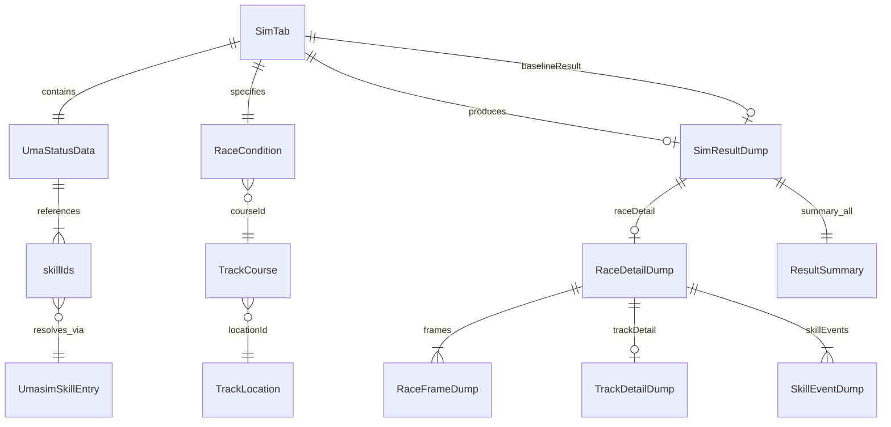

# ウマ娘 レースアナライザー — システム仕様書

> 別 AI によるプロジェクト評価用の技術概要ドキュメント。  
> 正本の進捗・要件は [`TODO.md`](../TODO.md)・[`PROJECT.md`](../PROJECT.md)・[`tasks/INDEX.md`](../tasks/INDEX.md) を参照。

**バージョン**: [`desktop-app/package.json`](../../desktop-app/package.json) の `version` が正本（`app/lib/version.ts` → UI、`tauri.conf.json` → Tauri、`sync-version` → Cargo）。運用: [`RELEASE_BUILD.md`](../RELEASE_BUILD.md#バージョン管理)  
**最終更新**: 2026-07-23 08:25（所持スキル数サマリー表示・実機検証クローズ）

---

## 1. アプリの目的とターゲット課題

### 1.1 目的

Steam版・DMM版「ウマ娘 プリティーダービー」向けの **Windows デスクトップレースアナライザー** である。ゲーム内の詳細ステータス画面をキャプチャし、OCR で数値・スキルを抽出し、**umasim WASM エンジン** でレースをシミュレーションして結果を可視化する。

ユーザーは育成済みウマ娘の「このスキル構成でこのレース条件だとどう走るか」を、ゲーム内で何度も試走せずに検証できる。

### 1.2 ターゲット課題

| 課題 | 本アプリの解決策 |
|------|------------------|
| ゲーム内ステータス画面の手入力は煩雑でミスが起きやすい | Win32 キャプチャ + 自動スクロール + OpenCV.js 画像結合 + Gemini OCR |
| OCR したスキル名とゲーム内部 ID の不一致 | `fuzzyMatcher.ts` によるファジーマッチング + `umasimSkillData.ts`（約 2,000 件） |
| レース結果の試行錯誤に時間がかかる | WASM Worker で N 回シミュレーション + 集計サマリ表示 |
| スキル ON/OFF・追加の比較がしづらい | 複数 **SimTab** 管理、baseline 比較、詳細グラフ diff |
| 1 走の挙動（速度・スタミナ・スキル発動タイミング）が見えない | `runSimulationDetail` によるレース詳細グラフ（Recharts + Canvas インタラクション） |
| API キーの平文保存リスク | Windows 資格情報マネージャー（`keyring` crate） |

### 1.3 対象ユーザー・環境

- **対象 OS**: Windows 10/11（64bit）のみ（Win32 / Tauri ベース）
- **対象ゲーム**: Steam版・DMM版「ウマ娘 プリティーダービー」
- **検証済み解像度**: FHD（1920×1080）。DPI 100%〜125% 推奨
- **ネットワーク必須**: Gemini API（OCR）、GitHub（umasim `skill_data.txt` の WASM 実行時 fetch）

### 1.4 スコープ外（廃止済み）

- 因子管理 DB
- Tesseract OCR
- Supabase 連携
- macOS / Linux 対応
- `webapp/`（旧 TypeScript 物理エンジン）— 削除済み。シミュレーションは umasim WASM のみ

---

## 2. 使用技術（テックスタック）

### 2.1 全体アーキテクチャ

```
[Unity ゲームウィンドウ]
        ↓ Win32 BitBlt（Rust / Tauri）
[キャプチャフレーム列]
        ↓ OpenCV.js テンプレートマッチング結合（フロント）
[結合画像]
        ↓ Google Gemini API（フロント fetch）
[UmaStatusData（ステータス + skillIds）]
        ↓ fuzzyMatcher + umasimSkillData
[シミュレーション入力]
        ↓ umasim WASM Web Worker（public/umaemu/）
[SimResultDump + RaceDetailDump]
        ↓ Recharts + Canvas overlay
[結果カード + レース詳細グラフ]
```

### 2.2 フロントエンド

| カテゴリ | 技術 | バージョン（目安） |
|---------|------|-------------------|
| フレームワーク | Next.js（App Router, `output: 'export'` 静的エクスポート） | 16.2.6 |
| UI ライブラリ | React | 19.2.4 |
| スタイル | Tailwind CSS | 4 |
| グラフ | Recharts, d3-shape | 3.8 / 3.2 |
| アイコン | lucide-react | 1.17 |
| セレクト UI | react-select | 5.10 |
| 文字列類似度 | string-similarity | 4.0 |
| テスト | Vitest | 4.1 |
| 言語 | TypeScript | 5 |

### 2.3 デスクトップ / ネイティブ（Rust）

| カテゴリ | 技術 | 用途 |
|---------|------|------|
| デスクトップフレームワーク | Tauri | 2.11.x |
| Win32 API | windows-sys | ウィンドウ検出・BitBlt キャプチャ・DPI |
| 画像処理 | image, imageproc | PNG 保存・フレーム差分 |
| 並列処理 | rayon | 行単位投票の並列化 |
| クリップボード | arboard | 画像コピー |
| 資格情報 | keyring（windows-native） | Gemini API キー永続化 |
| シリアライズ | serde, serde_json | Tauri コマンド I/O |
| 非同期 | tokio | Tauri 内部 |

**Tauri プラグイン**: `dialog`, `global-shortcut`, `window-state`, `single-instance`, `log`

### 2.4 シミュレーションエンジン

| 項目 | 内容 |
|------|------|
| エンジン | [umasim](https://github.com/mee1080/umasim)（Kotlin/JS → WASM） |
| 配布物 | `desktop-app/public/umaemu/race.js`, `worker.js`, `*.wasm` |
| 実行方式 | Web Worker 経由（`SIMULATE` / `SIMULATE_DETAIL` メッセージ） |
| ビルド | JDK 17+, Gradle（`tools/umasim-race-wasm/build-race-wasm.ps1`） |

### 2.5 データ抽出ツール

| 項目 | 内容 |
|------|------|
| ランタイム | Node.js |
| SQLite 読取 | better-sqlite3 12.10 |
| 入力 | `master.mdb`（ゲームマスタ、gitignore）, umasim `skill_data.txt` |
| 出力 | `umasimSkillData.ts`, `skillRarityData.ts` |

### 2.6 外部 API・統合

| 統合先 | 実装ファイル | 用途 |
|--------|-------------|------|
| **Google Gemini API** | `app/lib/geminiOcr.ts` | 結合画像からステータス・スキル名を OCR。モデル: `gemini-3.1-flash-lite` のみ（Auto-Fallback なし） |
| **GitHub (mee1080/umasim)** | `umaemuAdapter.ts`, extract スクリプト | WASM 実行時の `skill_data.txt` fetch、スキルマスタ生成 |
| **Windows Credential Manager** | `api_key.rs`, `apiKeyStorage.ts` | Service: `com.umamusume.race-analyzer` / `gemini_api_key` |
| **OpenCV.js** | `opencvStitcher.ts`, `(main)/layout.tsx` | キャプチャフレームのテンプレートマッチング結合（CDN/同梱参照） |

### 2.7 データ永続化方針

- **アプリ内ランタイム DB は存在しない**（SQLite / IndexedDB によるユーザー DB なし）
- ユーザー設定: `localStorage`（UI 状態）、Windows Credential Manager（API キー）
- スキルマスタ: ビルド時同梱 TypeScript（`umasimSkillData.ts`）+ WASM 実行時 GitHub fetch

---

## 3. 実装済みの主要機能

### 3.1 キャプチャ・画像処理

- ゲームウィンドウ自動検出（`UnityWndClass` + タイトルパターンマッチ）
- 手動スクロールキャプチャセッション（フレーム逐次取得）
- 自動スクロールキャプチャ（Rust 側でスクロール + キャプチャ）
- OpenCV.js による縦長ステータス画面の画像結合
- 結合画像のクリップボードコピー・ファイル保存
- グローバルショートカット（F9 等）によるキャプチャ起動

### 3.2 OCR・データ入力

- Gemini API による結合画像の OCR（ステータス 5 種、適性、スキル名リスト等）。モデルは `gemini-3.1-flash-lite` のみ（Auto-Fallback なし）
- **OCR 解析の中止**（`AbortController` / `AbortSignal`）: 解析中に CapturePanel 同一ボタンで「停止」。中止後は再 OCR 可能。遅延成功結果は破棄
- **ファイル OCR 入口**: CapturePanel の「画像ファイルを開く」で過去の結合済み縦長画像（PNG / JPEG）を選択し、プレビュー表示後に既存「画像からステータスを読込」へ進む。キャプチャ未実施でも OCR → ステータス/スキル → シミュレーションまで通せる。読込は `convertFileSrc` → `fetch` → dataUrl（plugin-fs の任意パス読取権限は増やさない）。ファイル由来ではクリップボード自動コピー・saveFolder への再保存を行わない。キャプチャ実行中（`recording`）および OCR 解析中は「画像ファイルを開く」を無効化。`resultImage` 更新時（ファイル差し替え・新規キャプチャ共通）は OCR 結果（`umaData`）をクリアし再 OCR を促す
- ファジーマッチングによる OCR スキル名 → umasim スキル ID 解決
- 手動編集: `StatusPanel` / `SkillPanel` でステータス・スキル調整
- **所持スキル数サマリー**: `SkillPanel` 見出し下および sim タブ「実行時のステータス条件」パネルに総数・金（rare）・進化（evo）を表示（`countSkillSummary` / `SkillSummaryLine`）。**実機検証クローズ**（2026-07-23 08:25）
- `SkillVerifier` によるスキル ID 検証・色分け表示

### 3.3 レース条件・シミュレーション

- 競馬場・コース・馬場状態・出走人数の選択（`RaceConditionSelector`）
- レース条件プリセット（`public/race_presets.json`）
- umasim WASM による N 回レースシミュレーション（進捗コールバック付き）
- 集計サマリ: 全体 / マックススパート / 非マックススパート別（勝率、平均タイム、スタミナキープ率等）
- シミュレーションエラー正規化・トースト通知（`simulationErrors.ts`）

### 3.4 スキル管理・比較

- 複数 **SimTab**（タブ）による並列シミュレーション管理（複製・リネーム・サムネイル）
- スキル ON/OFF（`disabledSkillIds`）と追加スキル（`addedSkillIds`）
- スキルコマンドパレット（`SkillCommandPalette`）— 検索・追加
- 通常固有スキルの先頭スロット制限（`canPlaceSkillAtIndex`）
- レアリティ別色分け表示（unique / inherit / evo / rare / normal）
- baseline タブとの比較（詳細グラフ diff オーバーレイ）

### 3.5 レース詳細グラフ（v1.1.0 の中核機能）

- 直近 1 走の詳細データ取得（`runSimulationDetail` / WASM）
- 速度・スタミナ・位置・レーンの時系列グラフ（双 Y 軸、単位 m/s）
- コース区間オーバーレイ（直線・コーナー・坂、`trackDetail`）
- スキル発動帯（赤線・ラベル・hover ツールチップ、効果量・持続時間）
- Google Map 型インタラクション（ホイールズーム、2D パン、ダブルクリックリセット）
- Dual-Viewport 構成（操作中 Canvas overlay、停止後 Recharts 本描画への handoff）
- スタミナキープ持続線、デバフ帯（`kind: debuff`）対応
- baseline グラフとの 2 系列オーバーレイ diff

### 3.6 UI / UX

- 全画面 Cockpit レイアウト（サイドバー折りたたみ、右カラム全幅グラフ）
- タブ keep-alive（切替時の再シミュレーション回避）
- 設定パネル折りたたみ（キャプチャ設定・API キー・自動コピー等）
- トースト通知（Portal 経由）
- システムトレイ（閉じる = 非表示、終了メニュー）
- 透過オーバーレイウィンドウ（`/overlay` ルート）— キャプチャ進捗表示

### 3.7 セキュリティ・設定

- Gemini API キーの Windows Credential Manager 保存（localStorage 非使用）
- API キー設定モーダル（`ApiKeyModal` / `SettingsPanel`）

### 3.8 開発・運用

- スキルデータ extract パイプライン（`npm run extract-umasim-skills`, `extract-skill-info`）
- リリースビルド（`npm run build:release-exe` → `app.exe` 単体配布）
- Vitest ユニットテスト（グラフ・シミュレーションエラー等）

### 3.9 未実装・Backlog（参考）

- keep-alive タブのメモリ負荷軽減（5 タブ以上想定）
- スキルパレットのレアリティ段階別ソート
- `skill_data.txt` 参照の一本化（自前 GitHub fetch 案）

---

## 4. データベース設計

### 4.1 概要

本アプリは **ランタイム用のデータベースを持たない**。データは以下の 3 層で管理される。

```
┌─────────────────────────────────────────────────────────────┐
│ 外部ソース（ゲームマスタ・コミュニティ）                      │
│  master.mdb ──extract──► skillRarityData.ts（レガシー UI 色） │
│  umasim skill_data.txt ──extract──► umasimSkillData.ts     │
│  umasim skill_data.txt ──runtime fetch──► WASM Worker       │
└─────────────────────────────────────────────────────────────┘
                              ↓
┌─────────────────────────────────────────────────────────────┐
│ アプリ内データモデル（TypeScript 型 + 静的 JSON/TS）          │
│  UmaStatusData, RaceCondition, SimTab, SimResultDump, ...   │
│  trackData.ts, race_presets.json                            │
└─────────────────────────────────────────────────────────────┘
                              ↓
┌─────────────────────────────────────────────────────────────┐
│ ランタイム状態（メモリ + ブラウザストレージ）                  │
│  React state（SimTab 配列）                                  │
│  localStorage（UI 設定）                                     │
│  Windows Credential Manager（API キー）                      │
└─────────────────────────────────────────────────────────────┘
```

### 4.2 外部マスタ DB（master.mdb）

ゲームの SQLite マスタファイル。リポジトリには含めず（`.gitignore`）、開発者がローカル配置して extract ツールが **読み取り専用** で参照する。

**参照テーブル**:

| テーブル | カラム | 用途 |
|---------|--------|------|
| `text_data` | `index`, `text`（`category=47` でフィルタ） | スキル名テキスト |
| `skill_data` | `id`, `rarity` | スキル ID とレアリティ数値 |

**生成物**: `skillRarityData.ts` — スキル名 → UI 色カテゴリ（`white` / `gold` / `green`）。現在は `umasimSkillData.ts` の `getSkillRarityInfoById` が表示正本。

### 4.3 スキルマスタ（umasimSkillData.ts）

`extract_umasim_skill_data.js` が umasim の `skill_data.txt` から生成。約 2,000 エントリ。

```typescript
interface UmasimSkillEntry {
  name: string;    // 表示名（OCR マッチングキー）
  id: string;      // umasim スキル ID
  rarity: string;  // unique | inherit | evo | rare | normal | special | minus 等
}
```

**関係性**:

- `UmaStatusData.skillIds[]` → `umasimSkillDataList` で名前・レアリティ解決
- `SkillCommandPalette` → `buildPaletteSkillOptions()` でフィルタ・dedupe
- WASM sim → 別経路で GitHub から同一形式の JSON を fetch（パレット/OCR は同梱 TS が正本）

### 4.4 コースデータ（trackData.ts）

```typescript
TrackLocation { id, name, courses: TrackCourse[] }
TrackCourse   { id, name, dist, type: '芝' | 'ダート' }
```

`RaceCondition.locationId` + `courseId` が `TrackLocation` / `TrackCourse` を参照。`aptitudeHelper.ts` が適性キー（芝/ダート、距離、脚質）を変換。

### 4.5 中核データモデル（`app/lib/types.ts`）

#### 入力系

| 型 | 主要フィールド | 説明 |
|----|---------------|------|
| `UmaStatusData` | speed, stamina, power, guts, wisdom, aptitudes, skillIds | OCR/手入力のウマ娘データ |
| `RaceCondition` | locationId, courseId, surfaceCond, playerNum | レース環境 |

#### タブ状態

| 型 | 主要フィールド | 説明 |
|----|---------------|------|
| `SimTab` | id, title, umaData, raceCondition, simResultDump, baselineResult, disabledSkillIds, addedSkillIds, thumbnailUrl | 1 シミュレーション単位の UI 状態 |

#### 出力系（WASM → フロント）

| 型 | 主要フィールド | 説明 |
|----|---------------|------|
| `SimResultDump` | iterations, summary{all, maxSpurt, nonMaxSpurt}, raceDetail | N 回集計 + 詳細 1 走 |
| `ResultSummary` | count, rate, avgTime, staminaKeepRate, ... | 集計サマリ指標 |
| `RaceDetailDump` | summary, frames[], courseLength, trackDetail, skillEvents | 1 走の時系列詳細 |
| `RaceFrameDump` | speed, sp, startPosition, currentLane | フレーム単位の走行データ |
| `TrackDetailDump` | straights[], corners[], slopes[] | コース区間 |
| `SkillEventDump` | skillId, startTime, endTime, kind, effectText | スキル発動イベント |

#### ER 図（論理モデル）



### 4.6 静的 JSON

| ファイル | 内容 |
|---------|------|
| `public/race_presets.json` | よく使う `RaceCondition` プリセット |
| `app/lib/skillRarityData.json` | レガシー（`.ts` が正本） |

---

## 5. ディレクトリ構成

### 5.1 リポジトリ全体

```
umamusume-skill-emulator/
├── desktop-app/                 ★ 本番アプリ（Next.js + Tauri）
│   ├── app/                     フロントエンド（App Router）
│   ├── public/                  静的アセット（WASM, presets, opencv.js 参照）
│   ├── scripts/                 リリースビルド・sync-cargo-version.js
│   ├── src-tauri/               Rust バックエンド
│   ├── package.json
│   └── next.config.ts
├── tools/
│   ├── mdb-extractor/           スキルデータ抽出（Node + better-sqlite3）
│   └── umasim-race-wasm/        WASM ビルド補助スクリプト
├── docs/                        プロジェクト文書
│   ├── TODO.md                  進捗管理正本
│   ├── PROJECT.md               プロジェクト概要正本
│   ├── CHANGELOG.md
│   ├── DOCS-GUIDE.md            docs 運用ガイド
│   ├── reference/
│   │   └── SYSTEM_SPECIFICATION.md  ← 本ドキュメント
│   └── tasks/                   REQ 要件ドキュメント群（INDEX.md あり）
├── .cursor/rules/               Cursor Agent 運用ルール
├── README.md
└── UPDATE_SKILLS.md             ゲーム更新後のデータ更新手順
```

### 5.2 desktop-app/app（フロントエンド）

```
app/
├── (main)/                      メインウィンドウ
│   ├── layout.tsx               ルートレイアウト（opencv.js 読込）
│   ├── page.tsx                 ホーム画面（キャプチャ→OCR→シミュレーション）
│   └── SimTabPanel.tsx          シミュレーション結果タブパネル
├── (overlay)/overlay/           透過オーバーレイウィンドウ
│   ├── layout.tsx
│   └── page.tsx
├── components/                  UI コンポーネント（17 ファイル）
│   ├── CapturePanel.tsx         キャプチャ UI
│   ├── StatusPanel.tsx          ステータス表示・編集
│   ├── SkillPanel.tsx           スキル一覧
│   ├── SkillCommandPalette.tsx  スキル追加パレット
│   ├── SkillVerifier.tsx        スキル検証
│   ├── RaceConditionSelector.tsx レース条件選択
│   ├── SimulationLauncher.tsx   シミュレーション実行
│   ├── SimulationStatusView.tsx 進捗表示
│   ├── ResultCard.tsx           集計結果カード
│   ├── RaceDetailChart.tsx      レース詳細グラフ
│   ├── TabBar.tsx               タブバー
│   ├── SettingsPanel.tsx        設定
│   ├── ApiKeyModal.tsx          API キー設定
│   └── ...
├── hooks/
│   ├── useCapture.ts            キャプチャセッション管理
│   ├── useChartViewInteraction.ts  グラフ pan/zoom
│   ├── useInteractionCanvasLoop.ts Canvas インタラクションループ
│   └── useToast.ts
├── lib/
│   ├── types.ts                 ★ 中核型定義
│   ├── geminiOcr.ts             Gemini OCR
│   ├── fuzzyMatcher.ts          スキル名ファジーマッチ
│   ├── opencvStitcher.ts        画像結合
│   ├── umasimSkillData.ts       ★ スキルマスタ（自動生成、~10k行）
│   ├── skillRarityData.ts       レアリティ UI 色（mdb 由来、レガシー）
│   ├── trackData.ts             コースマスタ
│   ├── aptitudeHelper.ts        適性キー変換
│   ├── raceGraphBuilder.ts      グラフデータ構築
│   ├── chartLineRenderer.ts     Canvas 線描画
│   ├── apiKeyStorage.ts         Tauri 経由 API キー操作
│   ├── version.ts               アプリ semver（正本: package.json）
│   └── engine/
│       ├── umaemuAdapter.ts     ★ WASM Worker ラッパ
│       └── simulationErrors.ts  エラー正規化
└── globals.css
```

### 5.3 desktop-app/src-tauri（Rust バックエンド）

```
src-tauri/
├── src/
│   ├── main.rs                  エントリポイント
│   ├── lib.rs                   Tauri Builder・コマンド登録・トレイ
│   ├── capture.rs               Win32 キャプチャ・自動スクロール
│   ├── window.rs                ゲームウィンドウ検出（EnumWindows）
│   ├── stitch.rs                画像保存・クリップボード
│   ├── overlay.rs               透過オーバーレイウィンドウ
│   └── api_key.rs               Windows Credential Manager
├── capabilities/
│   ├── default.json             main ウィンドウ権限
│   └── overlay.json             overlay ウィンドウ権限
├── Cargo.toml
├── tauri.conf.json
└── build.rs
```

### 5.4 desktop-app/public（静的アセット）

```
public/
├── umaemu/
│   ├── race.js                  umasim WASM ブリッジ
│   ├── worker.js                Web Worker エントリ
│   └── *.wasm                   WASM バイナリ
└── race_presets.json            レース条件プリセット
```

### 5.5 tools/

```
tools/
├── mdb-extractor/
│   ├── package.json
│   ├── extract_umasim_skill_data.js   → umasimSkillData.ts
│   └── extract_rarity_from_mdb.js     → skillRarityData.ts
└── umasim-race-wasm/
    ├── build-race-wasm.ps1
    ├── WasmEngine.kt
    └── SkillData.patch.md
```

---

## 6. Tauri コマンド一覧（IPC 境界）

| コマンド | モジュール | 用途 |
|---------|-----------|------|
| `start_capture_session` | capture.rs | 手動スクロールキャプチャ開始 |
| `stop_capture_session` | capture.rs | キャプチャ停止・フレーム返却 |
| `start_auto_scroll_capture_session` | capture.rs | 自動スクロールキャプチャ |
| `save_and_copy_result` | stitch.rs | 結合画像の一時保存 |
| `copy_image_to_clipboard` | stitch.rs | クリップボードへ画像コピー |
| `save_stitched_image` | stitch.rs | 結合画像のファイル保存 |
| `init_overlay` / `show_overlay` / `hide_overlay` | overlay.rs | オーバーレイウィンドウ制御 |
| `set_gemini_api_key` / `get_gemini_api_key` / `has_gemini_api_key` / `delete_gemini_api_key` | api_key.rs | API キー CRUD |

**Tauri イベント**: `capture-complete`（キャプチャ完了）, `overlay-status`（オーバーレイ状態）

---

## 7. 配布・ビルド

| 項目 | 内容 |
|------|------|
| 配布形式 | インストーラーなし。`desktop-app/src-tauri/target/release/app.exe` を直接配布 |
| ビルドコマンド | `cd desktop-app` → `npm run build:release-exe` |
| フロントビルド | Next.js `output: 'export'` → `desktop-app/out/` → Tauri `frontendDist` |

---

## 8. 関連ドキュメント

| ドキュメント | 内容 |
|-------------|------|
| [`README.md`](../README.md) | セットアップ・動作環境 |
| [`docs/PROJECT.md`](../PROJECT.md) | プロジェクト正本（触ってはいけない領域等） |
| [`docs/TODO.md`](../TODO.md) | 進捗・Backlog |
| [`docs/tasks/INDEX.md`](../tasks/INDEX.md) | 全 REQ 索引 |
| [`UPDATE_SKILLS.md`](../../UPDATE_SKILLS.md) | スキルデータ更新手順 |
| [`docs/RELEASE_BUILD.md`](../RELEASE_BUILD.md) | app.exe ビルド手順 |
| [`docs/CHANGELOG.md`](../CHANGELOG.md) | 更新履歴 |
| [`docs/DOCS-GUIDE.md`](../DOCS-GUIDE.md) | docs 運用ガイド |
